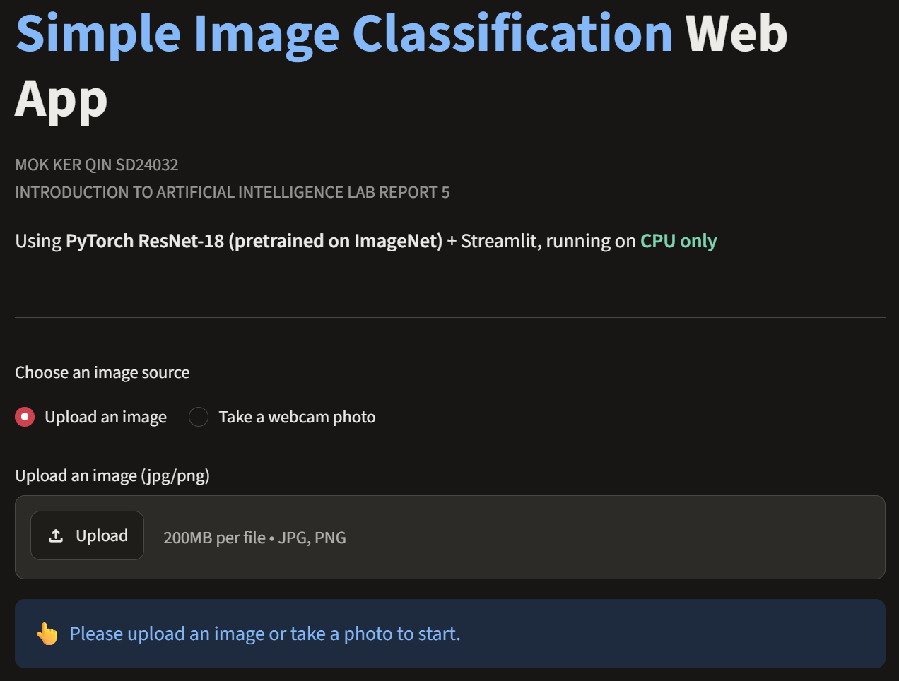
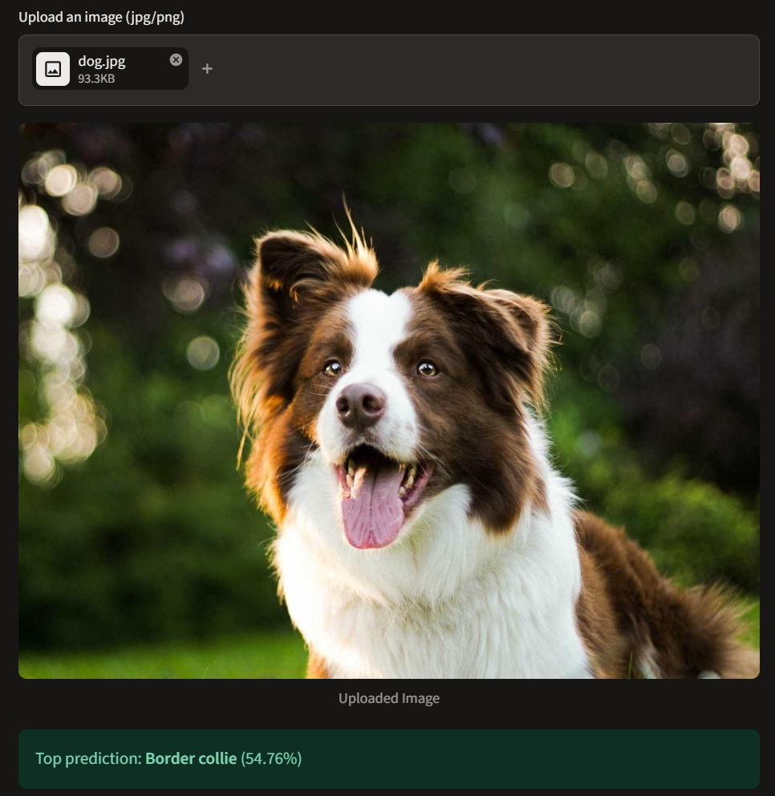
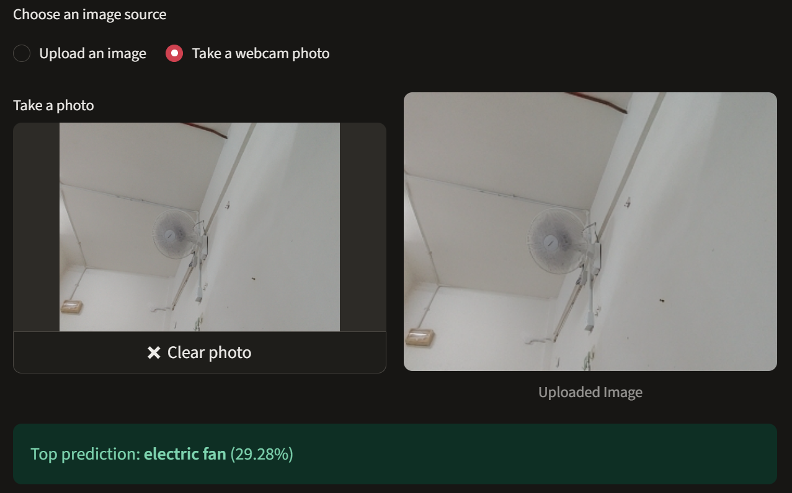
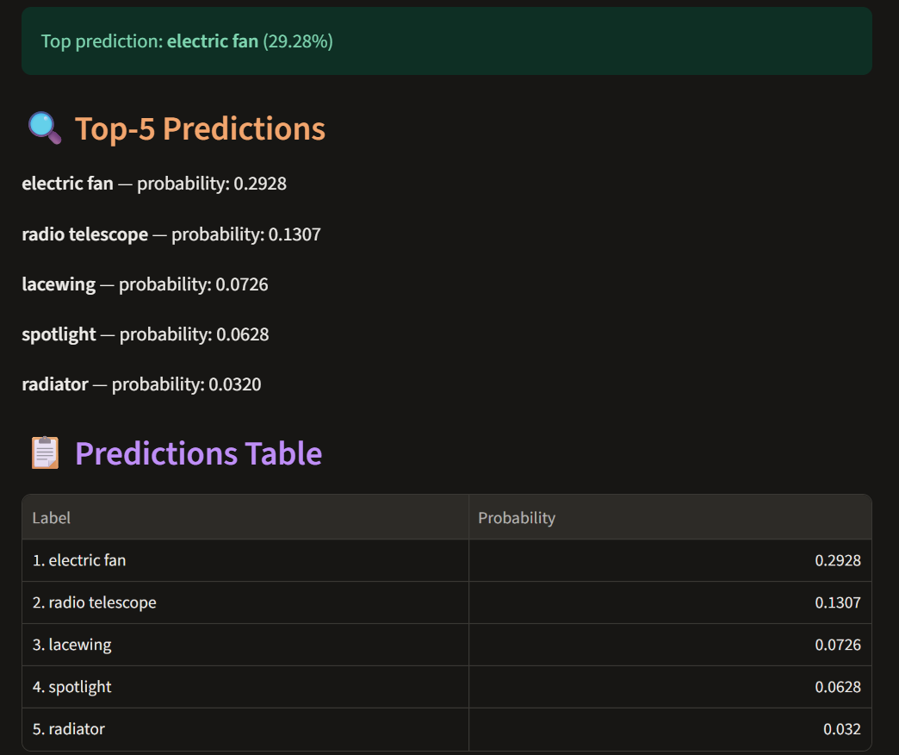
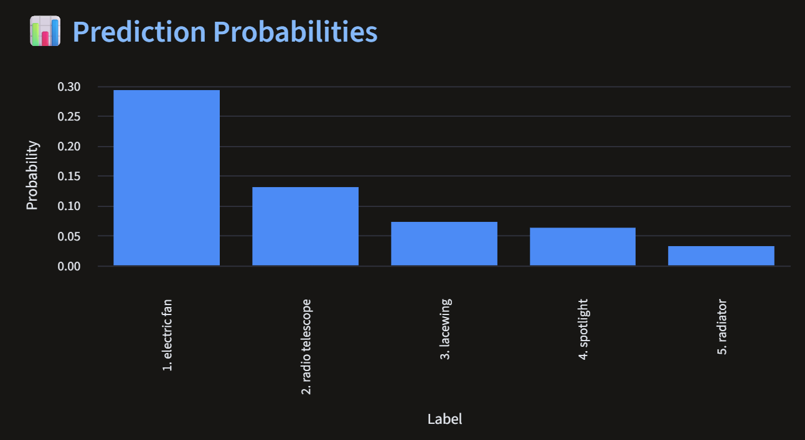

# ResNet18 | CPU Image Classification

[](https://ailabreport5-sd24032.streamlit.app/)

BSD3513 Introduction to Artificial Intelligence — Lab Report 5 · Mok Ker Qin · UMPSA

A Streamlit app that classifies images on CPU using a pre-trained ResNet18 model (ImageNet, 1,000 classes) and shows the top-5 predictions.

**Live app:** https://ailabreport5-sd24032.streamlit.app/



## Features
- Upload a JPG/PNG image for classification
- Take a webcam photo as an alternative image source
- Pre-trained ResNet18 with its recommended preprocessing, running on CPU only
- Top-5 predictions with softmax probabilities in a list and table
- Bar chart of the top-5 probabilities

| Image upload | Webcam photo |
|---|---|
|  |  |

| Top-5 predictions | Probability bar chart |
|---|---|
|  |  |

## Run locally
1. Download this repo (green Code button → Download ZIP) and unzip it.
2. Open a terminal in the folder and run:
```bash
pip install -r requirements.txt
streamlit run app.py
```

## Project structure
```
app.py               # Streamlit app
requirements.txt     # dependencies
screenshots/         # README images
testing images/      # upload images for testing
```

## Version
**v1.0** — ResNet18 top-5 classification, webcam input, probability bar chart.
